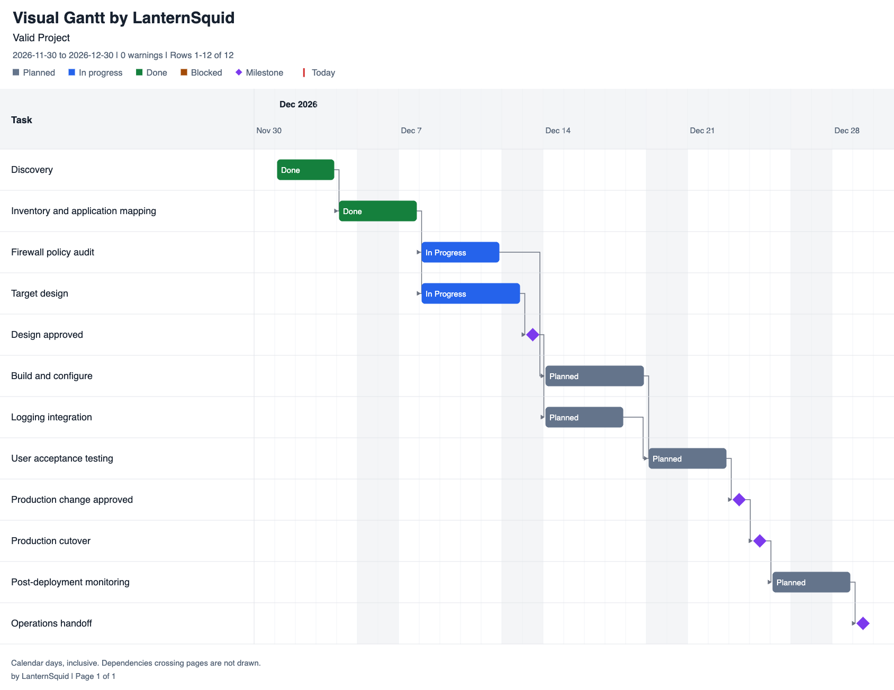

# Visual Gantt for Bases
by LanternSquid

A project timeline view for Obsidian Bases. Version **0.7.1** is a desktop beta for community testing.

## Features

- Day, Week, and Month zoom, saved per Base view.
- Adjustable task-column width from 180 to 520 pixels, saved per view.
- Pinned task labels and date headers, month and year headings, and weekend shading at Day and Week zoom.
- Distinct Planned, In progress, Done, and Blocked colors, milestone diamonds, and a text legend.
- A Today marker based on the computer's local calendar date. Today expands and centers the range when needed. Project restores the scheduled range. The marker refreshes after midnight while Obsidian stays open.
- Missing, ambiguous, overlapping, self-referencing, circular, and invalid-date warnings.
- PNG export of the full displayed date range and all tasks. PDF export paginates the range and task rows into landscape pages with repeated labels and dates.
- Optional date editing with a review dialog, stale-data and dependency checks, and one-step Undo.

## Validation status

The final build is installed and verified in Obsidian 1.15.1 on macOS. A date move saved, Undo restored the original dates, and an overlapping move was rejected. The final PDF contains two valid pages for the sample project. Light and dark rendering passed inspection. Automated checks pass. See `docs/QA.md` for the remaining platform coverage. The public source repository is https://github.com/ExploitedBlackDuck/visual-gantt-bases. Community-directory submission and independent review are separate steps.



## Requirements

Obsidian **1.15.1 or newer on desktop**. Application testing has been completed on macOS with Obsidian 1.15.1. Windows, Linux, and third-party theme testing remain open for beta reviewers. Mobile installation is disabled until device testing is completed. Mocked cross-platform tests aren't a substitute for application testing.

## Install or update

Copy `main.js`, `manifest.json`, and `styles.css` into `<vault>/.obsidian/plugins/visual-gantt-bases/`. Enable the Bases core plugin and Visual Gantt for Bases under Community plugins. Reload Obsidian after updating the files. Existing `visual-gantt` views keep working.

To try the included project, open `demo-vault` as a vault, trust its plugins, and enable Visual Gantt for Bases. Open `01 - Valid Project.base`. It contains 12 tasks, 13 dependencies, and four milestones. `02 - Validation Errors.base` deliberately reports seven warnings and draws six of its eight task notes.

## Task properties

```yaml
---
title: Firewall policy audit
start: "2026-12-08"
end: "2026-12-11"
status: In Progress
depends_on:
  - "[[02 - Inventory]]"
---
```

Use date-only `YYYY-MM-DD` values. Timestamp values are rejected rather than silently truncated. Task title, status, dependency, milestone, and date property names can be changed in the Base view configuration. Date properties must be distinct from the other property mappings.

A milestone has matching start and end dates. You can also set `milestone: true`, but its dates must still match. Dependencies are finish-to-start. A predecessor must finish before its successor starts. Plain note names and wiki links are supported. Use full vault paths to disambiguate duplicate names. Commas in YAML list members and wiki-linked note names are preserved.

## Controls

**Zoom** changes the number of pixels per calendar day. Week and Month are useful for longer projects. They don't change any task dates. Short bars hide their status text when it won't fit. Hover or focus to inspect their dates and status.

**Task width** changes the pinned label column. The same setting is available in the Base view options.

**Today** includes today when it falls outside the scheduled range and centers it when possible. **Project** returns to the project's dates. A two-year range limit prevents an extremely distant Today jump.

**PNG** and **PDF** create new files in `Visual Gantt Exports` inside the current vault. Open export opens the newest file in a new tab. Exports use a light background regardless of the current theme. PNG includes the full chart. PDF repeats labels and dates on each page and omits dependency connectors that cross page boundaries. The PDF contains rasterized chart pages, so the chart text isn't searchable or tagged for screen readers. The interactive chart retains accessible labels and keyboard controls.

## Reschedule and Undo

Editing starts off. Open the Base's view menu, use the arrow beside its name, and enable experimental date editing. Click a bar or drag it by calendar days. A focused editable bar also opens with Enter or Space. Save dates confirms the change. Cancel leaves the note unchanged. The drag scale follows the selected zoom.

The plugin checks current date and dependency values across the rendered valid task set before saving. It checks the edited note again in `FileManager.processFrontMatter`. It also rejects changed milestone flags, missing task files, conflicting date ranges, and simultaneous plugin saves.

Undo restores the latest successful plugin date edit in the current session. It checks current dates, dependencies, property mappings, and the set of task paths in the Base. It isn't a general history system and clears after a reload. Undo restores date values, but doesn't reverse YAML formatting changes made by Obsidian.

These checks aren't an atomic transaction across multiple notes. External editors or sync can still change another note after it was checked. Dependencies outside the filtered Base aren't enforced. Use a backup for important work.

## Limits

- At most 500 included notes and a roughly two-year date range per chart. Narrow the Base to inspect a larger dataset.
- PNG exports are limited to 16 million rendered pixels and a maximum canvas side of 16,384 pixels. Use PDF or a smaller zoom for larger charts.
- PDF exports are limited to 100 pages. Narrow the Base or reduce zoom for larger exports.
- No automatic rescheduling, critical-path calculation, multi-step Undo, or mobile support.

## Privacy and dependencies

There are no runtime packages beyond Obsidian. The plugin makes no network requests and has no telemetry, ads, payments, or account requirement. It uses public Obsidian and Web APIs. Note reads, date edits, and exports stay within the current vault.

## Development and review

Use Node.js 22 or newer and run `npm test`. There's no npm install or build step. `main.js` is both the source and the runtime release asset. See `CONTRIBUTING.md`, `docs/QA.md`, `docs/RELEASE.md`, and `SECURITY.md` for testing, release, and reporting details.

Licensed under the MIT license. Copyright 2026 LanternSquid.
